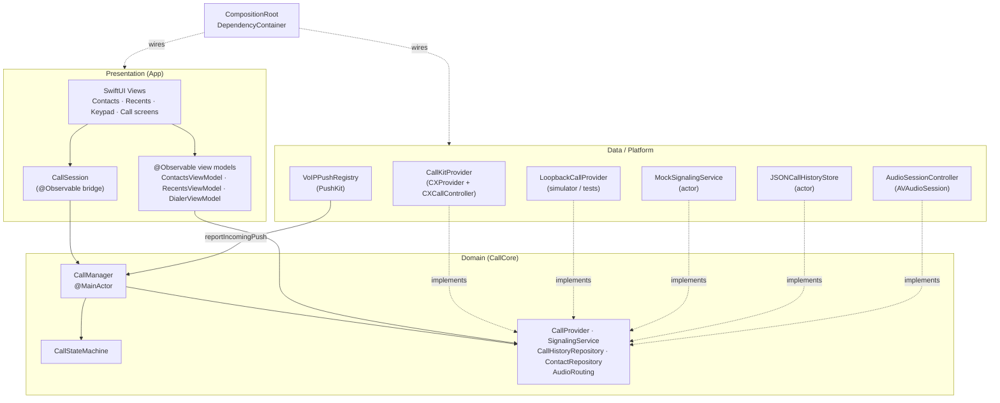
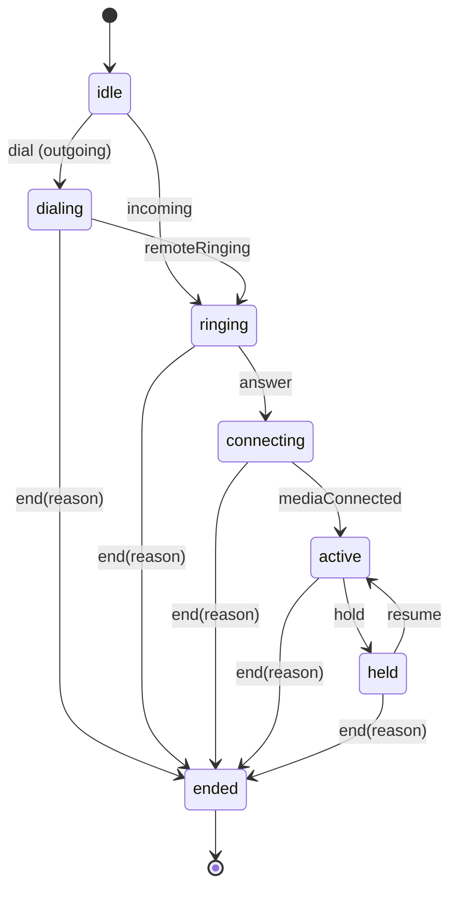
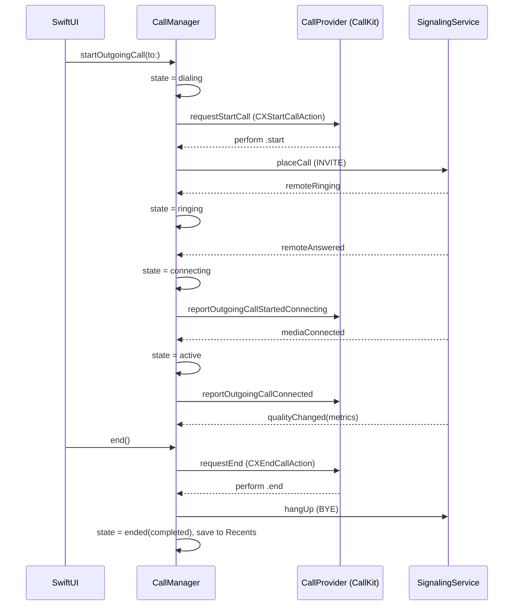

# swiftui-voip-call

A SwiftUI VoIP calling app built around an explicit call state machine, CallKit, PushKit and a pluggable signaling layer. It runs end to end in the simulator with no server.

[](https://github.com/trsimanto/swiftui-voip-call/actions/workflows/ios.yml)


Calling apps are mostly about getting the edge cases right: the callee picks up just as you hang up, a second call comes in mid-conversation, the user ends the call from the lock screen, the network drops between INVITE and answer. This project shows how I structure that logic so it stays predictable and testable, using the same approach I use on production VoIP and chat apps.

---

## Features

- **Contacts and dialer**: searchable contacts with favourites, and a 12-key dialer with paste support and long-press `0` for `+`.
- **Recents**: call history grouped by day, an All/Missed filter, swipe to delete, tap to call back and a missed-call badge. Stored as JSON through an actor-based store.
- **Incoming call screen**: accept or decline, with a pulsing avatar.
- **In-call screen**: live timer, mute, speaker, hold/resume, DTMF keypad and end call. Each control is enabled only in the states where it applies.
- **Call quality indicator**: four signal bars driven by a simplified ITU-T G.107 E-model MOS estimate from RTT, jitter and packet loss.
- **Explicit `CallStateMachine`**: `idle → dialing → ringing → connecting → active ⇄ held → ended`. Invalid transitions are rejected and reported, never applied.
- **CallKit integration**: `CXProvider`/`CXCallController` wrapper, so lock-screen, Bluetooth and CarPlay controls go through the same path as the in-app buttons.
- **PushKit VoIP registration**, which reports to CallKit before the push completion handler runs, as iOS 13+ requires.
- **`AVAudioSession` helper**: `.playAndRecord` with `.voiceChat`, 48 kHz, 10 ms IO buffers and speaker override.
- **`MockSignalingService`**: a simulated SIP/WebRTC-style far end with configurable delays, busy/decline/no-answer/network-failure behaviours, random failure injection and quality reports.
- **Simulate incoming call** from the Contacts toolbar. On a device, lock the phone to see the native CallKit UI.

### Demo numbers

Some sample contacts are wired to specific outcomes so every branch of the flow can be tried from the UI:

| Contact | Outcome |
|---|---|
| Busy Line | Remote is busy |
| Ioana Popescu | Rings, then declines |
| Voicemail Test | Rings until the no-answer timeout |
| Offline Server | INVITE fails (network error) |
| Anyone else | Answers, then streams quality reports |

---

## Tech stack

| Area | Choice |
|---|---|
| Language | Swift 5.9+ (Swift Concurrency: `async`/`await`, actors, `AsyncStream`) |
| UI | SwiftUI, iOS 17, `@Observable` / `@Bindable`, `TimelineView`, `ContentUnavailableView` |
| Architecture | MVVM + Clean Architecture (Presentation / Domain / Data) |
| DI | Protocol-based, composed in one `CompositionRoot` through a small `DependencyContainer` |
| Telephony | CallKit (`CXProvider`, `CXCallController`), PushKit (`PKPushRegistry`) |
| Audio | AVFoundation (`AVAudioSession`) |
| Persistence | JSON file store behind `CallHistoryRepository` (actor) |
| Testing | XCTest: state machine, CallManager, signaling mock, stores, view models |
| Project | XcodeGen (`project.yml`) + Swift Package for `CallCore` |
| CI | GitHub Actions on `macos-latest`: `swift test` and `xcodebuild test` on an iOS simulator |
| Linting | SwiftLint config included (`.swiftlint.yml`) |

---

## Architecture

The code is split into a platform-free core and a thin iOS shell around it.

- **CallCore** (`Packages/CallCore`) uses Foundation only. It holds the domain models, the state machine, `CallManager`, the protocols, and the data-layer implementations that don't need iOS frameworks (mock signaling, loopback provider, JSON history store). It builds as a Swift package, so `swift test` exercises the core logic without a simulator.
- **App** (`App/`) contains SwiftUI views and `@Observable` view models, plus the iOS-only adapters: `CallKitProvider`, `VoIPPushRegistry` and `AudioSessionController`.



### Call state machine

All transition rules live in a single `switch` in `CallStateMachine.nextState(from:on:)`. Anything not listed there is rejected with `InvalidCallTransition`. Late or duplicated signaling messages, such as a stray `180 Ringing` after the call is up, are reported as diagnostics and leave the state unchanged.



End reasons are `completed`, `cancelled`, `declined`, `missed`, `busy`, `unanswered` and `failed`. `CallManager` chooses the reason from the direction and the state at the time the call ends. For example, hanging up an incoming call that is still ringing counts as *declined*, and the caller giving up before we answer counts as *missed*.

### How a call flows

User intents never mutate state directly. They go out as provider requests (CallKit transactions on device) and come back as provider actions. That is why ending a call from the lock screen, from AirPods or from the in-app button follows the same code path.



### Concurrency model

- `CallManager` is `@MainActor`. Call state is small and bound to the UI, and a single serial executor rules out races between CallKit callbacks and signaling events.
- I/O lives behind actors: `MockSignalingService` (a real client would wrap a WebSocket here) and `JSONCallHistoryStore`.
- Events cross boundaries as `AsyncStream`s. `CallManager.updates()` is a multicast stream that replays the current call to new subscribers.
- Network round trips are started in child tasks, so the provider event loop never blocks. The user can still cancel while an INVITE is in flight.

---

## Project structure

```
swiftui-voip-call/
├── project.yml                      # XcodeGen spec (app, framework, test targets, scheme)
├── Config/VoIPCall-Info.plist
├── App/
│   ├── Application/                 # @main app, AppDelegate (early PushKit registration)
│   ├── DI/                          # CompositionRoot, AppEnvironment
│   ├── Platform/
│   │   ├── CallKit/                 # CallKitProvider + CXProviderDelegate proxy
│   │   ├── PushKit/                 # VoIPPushRegistry, payload parsing
│   │   └── Audio/                   # AudioSessionController (AVAudioSession)
│   ├── Presentation/
│   │   ├── Root/                    # TabView + full-screen call presentation
│   │   ├── Contacts/                # ContactsView, ContactsViewModel
│   │   ├── Recents/                 # RecentsView, RecentsViewModel
│   │   ├── Dialer/                  # DialerView, DialerViewModel
│   │   ├── Call/                    # CallSession, Incoming/Active call screens, presenter
│   │   └── Components/              # Keypad, Avatar, CallQualityIndicator
│   └── Resources/Assets.xcassets
├── AppTests/                        # View model + presenter + end-to-end session tests
├── Packages/CallCore/
│   ├── Package.swift
│   ├── Sources/CallCore/
│   │   ├── Domain/
│   │   │   ├── Models/              # Call, CallRecord, Contact, CallQuality, CallEndReason
│   │   │   ├── StateMachine/        # CallState, CallEvent, CallStateMachine
│   │   │   ├── Protocols/           # CallProvider, SignalingService, repositories, AudioRouting
│   │   │   └── Services/            # CallManager
│   │   ├── Data/
│   │   │   ├── Signaling/           # MockSignalingService
│   │   │   ├── Providers/           # LoopbackCallProvider
│   │   │   └── Repositories/        # JSON / in-memory history, sample contacts
│   │   └── Support/                 # DependencyContainer, CallDurationFormatter
│   └── Tests/CallCoreTests/
└── .github/workflows/ios.yml
```

---

## Running

Requirements: macOS with **Xcode 15 or later** (iOS 17 SDK) and [XcodeGen](https://github.com/yonaskolb/XcodeGen).

```bash
git clone https://github.com/trsimanto/swiftui-voip-call.git
cd swiftui-voip-call

brew install xcodegen && xcodegen
open VoIPCall.xcodeproj
```

Select the **VoIPCall** scheme and an iPhone simulator, then run.

- In the **simulator** the app uses `LoopbackCallProvider` instead of CallKit, because CallKit can't place outgoing calls there. Everything else (state machine, signaling, history, UI) is the same code that runs on a device.
- On a **device** the app uses CallKit. Set your team under *Signing & Capabilities*. To receive real VoIP pushes, add the *Push Notifications* capability and send a PushKit payload in this shape:

  ```json
  { "call_id": "6F1C1A4E-0C1B-4C9E-9D7B-2A4B8F0E1C11", "handle": "+15550100101", "caller_name": "Ayesha Rahman" }
  ```

- To force the loopback provider on a device, add the launch argument `-useLoopbackProvider`.

The `.xcodeproj` isn't committed. Run `xcodegen` again after adding or moving files.

---

## Testing

The core package tests run anywhere a Swift toolchain is installed, with no simulator needed:

```bash
swift test --package-path Packages/CallCore
```

To run the full suite (core and app tests) on a simulator:

```bash
xcodegen
xcodebuild test \
  -project VoIPCall.xcodeproj \
  -scheme VoIPCall \
  -destination 'platform=iOS Simulator,name=iPhone 15' \
  CODE_SIGNING_ALLOWED=NO
```

Change the simulator name to one installed on your machine. `xcrun simctl list devices available` lists them.

What is covered:

| Suite | Focus |
|---|---|
| `CallStateMachineTests` | Every valid path, end from every in-progress state, a table of invalid transitions (state must not change), history tracking |
| `CallManagerTests` | Outgoing/incoming happy paths, decline, missed, busy-while-in-call, VoIP push de-duplication, hold/resume, mute, speaker, DTMF, signaling and provider failures, stale events, ended-call lifecycle |
| `MockSignalingServiceTests` | Event sequences per remote behaviour, registration, failure injection, hold/DTMF bookkeeping, quality reports |
| `CallHistoryStoreTests` | Ordering, persistence across instances, replace by id, delete, trimming to the cap, recovery from a corrupt file |
| `CallDurationFormatterTests`, `CallQualityTests` | Timer and Recents formatting, MOS buckets and monotonicity |
| `SupportTests` | DI container lifetimes, contact search and initials, loopback provider |
| `AppTests` | Dialer input rules, Recents grouping/filtering, call screen status text, end-to-end `CallSession` against the real `CallManager` |

`CallManager` tests use hand-written doubles (`StubSignalingService`, `ControllableCallProvider`, `SpyAudioRouting`) and an injected clock, so durations are asserted exactly instead of with timing tolerances.

CI runs both suites on every push and pull request. See [`.github/workflows/ios.yml`](.github/workflows/ios.yml).

---

## Roadmap

- [ ] Real signaling client: SIP over WebSocket (RFC 7118) or a WebRTC signaling channel behind `SignalingService`
- [ ] WebRTC media (`RTCPeerConnection`) started from `audioSessionDidActivate`, with real `getStats()` feeding `CallQuality`
- [ ] Call waiting: hold the active call and answer the second one, instead of always rejecting it as busy
- [ ] Contacts framework integration and caller ID via a Call Directory extension
- [ ] Video calls (`supportsVideo`) with picture-in-picture
- [ ] SwiftData history store as an alternative `CallHistoryRepository`
- [ ] Snapshot tests for the call screens and UI tests for the main flows
- [ ] Localisation and full Dynamic Type audit

---

## Author

**Towhidur Rahman** — Lead Mobile Developer · [linkedin.com/in/trsimanto](https://www.linkedin.com/in/trsimanto)

Released under the [MIT License](LICENSE).
